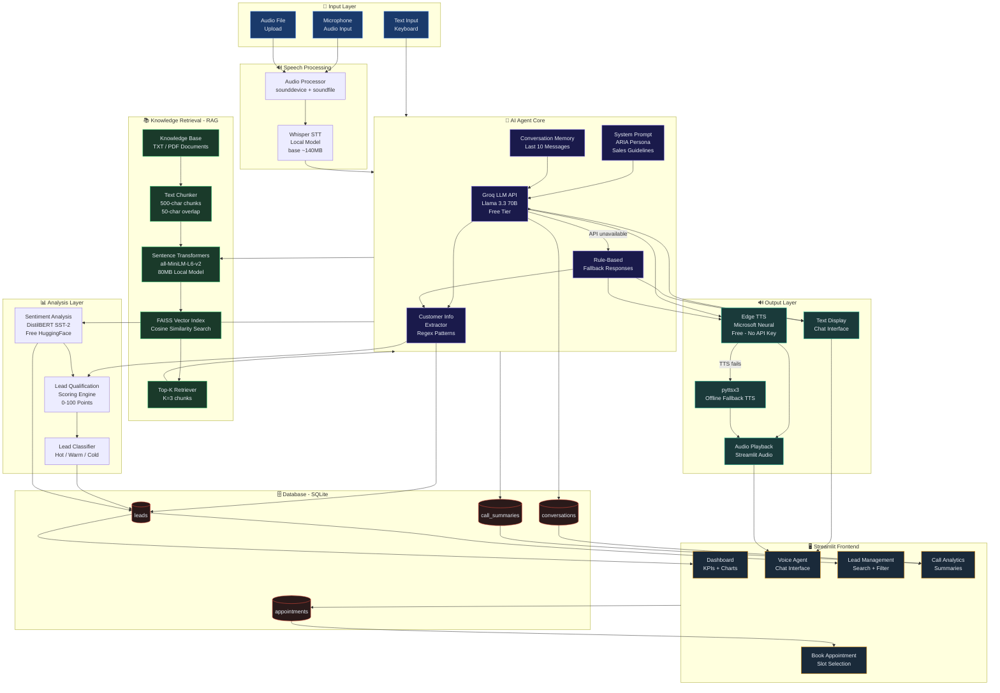
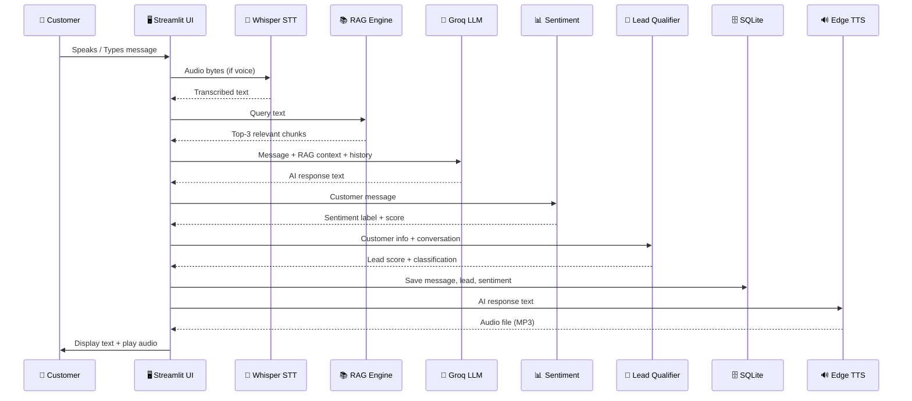
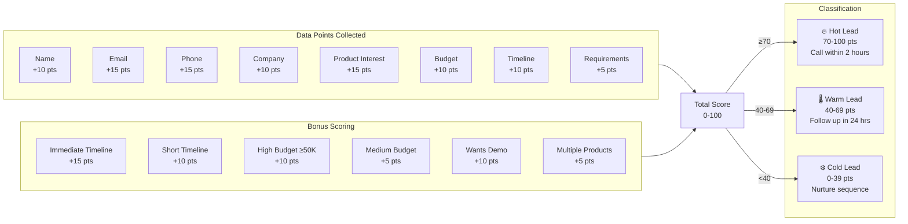

# System Architecture — Autonomous AI Sales Voice Agent

## Complete System Architecture



---

## Module Interaction Flow



---

## Lead Scoring System



---

## Database Schema

```mermaid
erDiagram
    LEADS {
        int id PK
        text session_id UK
        text name
        text email
        text phone
        text company
        text product_interest
        text budget
        text timeline
        text requirements
        int lead_score
        text lead_classification
        text classification_reason
        text sentiment
        real sentiment_score
        int appointment_booked
        timestamp created_at
        timestamp updated_at
    }

    CONVERSATIONS {
        int id PK
        text session_id FK
        text role
        text content
        text sentiment
        timestamp timestamp
    }

    APPOINTMENTS {
        int id PK
        text session_id FK
        text customer_name
        text customer_email
        text customer_phone
        text appointment_date
        text appointment_time
        text appointment_type
        text status
        text notes
        timestamp created_at
    }

    CALL_SUMMARIES {
        int id PK
        text session_id UK FK
        text summary
        text customer_requirements
        text lead_classification
        text sentiment_overall
        text appointment_status
        text next_action
        int total_messages
        int duration_seconds
        timestamp created_at
    }

    LEADS ||--o{ CONVERSATIONS : "has"
    LEADS ||--o| APPOINTMENTS : "books"
    LEADS ||--o| CALL_SUMMARIES : "generates"
```
